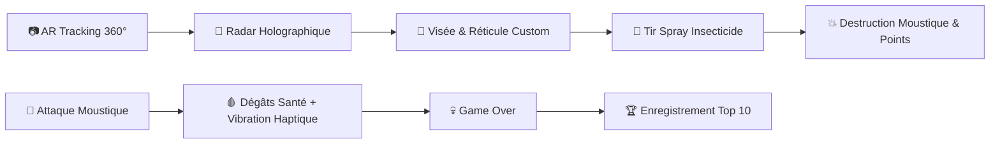

# 🦟 Eh-Oh-Mosquitoes (Eh Oh Mosquitoes)

[](https://unity.com/)
[](https://developer.vuforia.com/)
[](https://www.android.com/)
[](https://docs.microsoft.com/dotnet/csharp/)
[]()
[]()

**Eh-Oh-Mosquitoes** est un jeu mobile de tir immersif en **Réalité Augmentée (AR)** inspiré de l'art et des traditions culturelles camerounaises (**Art royal Ndop**). Plongé dans son environnement réel à 360°, le joueur incarne un chasseur intrépide (**"Chasseur K-Mer"**) armé de son spray insecticide pour traquer et neutraliser des essaims de moustiques agressifs avant de succomber à leurs piqûres !

---

## 📑 Sommaire

- [🌟 Points Forts & Direction Artistique](#-points-forts--direction-artistique)
- [🎮 Mécaniques de Jeu (Gameplay)](#-mécaniques-de-jeu-gameplay)
- [⚙️ Paramètres & Personnalisation Complète](#️-paramètres--personnalisation-complète)
- [🏆 Système de Classement Local (Hall of Fame)](#-système-de-classement-local-hall-of-fame)
- [🏗 Architecture Technique & Scripts](#-architecture-technique--scripts)
- [📁 Structure du Projet](#-structure-du-projet)
- [🚀 Installation & Déploiement](#-installation--déploiement)
- [👥 Crédits & Contact](#-crédits--contact)

---

## 🌟 Points Forts & Direction Artistique

### 🎨 Ambiance Culturelle & Identité Visuelle Ndop
- **Motifs et textiles Ndop** : Inspiré des tissus royaux traditionnels bamiléké de l'ouest du Cameroun, l'interface graphique intègre des chevrons, rubans gravés et textures modulaires personnalisées.
- **Palette africaine authentique** :
  - **Or Africain (`#F5B82E`)** : Boutons d'action majeurs, badges de victoire et dorures d'élite.
  - **Vert Ndop (`#5A8546`)** : Boutons secondaires, accents végétaux et réticules furtifs.
  - **Rouge Alerte (`#D63428`)** : Indicateurs de dégâts, piqûres et actions critiques.
  - **Bois Sombre / Fond Nuit (`#131B12`, `#1A1D24`)** : Panneaux sculptés offrant un contraste lisible et élégant.

### 🎵 Expérience Sonore Multi-Canaux & Folklore Camerounais
- **Musique originale Makossa / Afro-beat** : Riffs entraînants de guitare électrique camerounaise, percussions polyrythmiques et balafons traditionnels.
- **Bourdonnement 3D spatialisé** : Les moustiques émettent un son directionnel 3D dans l'espace AR, guidant les oreilles du joueur vers leur position.
- **Effets SFX percutants** : Sons de pulvérisation de spray, claquements de mort, bruitages de piqûres subies et jingles de victoire / défaite célébrant l'ambiance du jeu.

---

## 🎮 Mécaniques de Jeu (Gameplay)



1. **Traque AR à 360°** :
   - Détection et tracking continu de l'environnement réel via le moteur **Vuforia AR** (avec compatibilité ARCore / ARKit).
   - Les moustiques volent autour du joueur à différentes hauteurs et distances dynamiques.
2. **Radar Holographique 360° (`MosquitoRadarArrow`)** :
   - Aiguille de guidage orbitale dynamique qui tourne autour du viseur pour pointer avec précision vers le moustique le plus proche, même lorsqu'il se trouve hors du champ de vision de la caméra.
   - Rayon d'orbite et activation personnalisables dans les options.
3. **Système de Tir Dynamique** :
   - Projectiles de spray instanciés depuis le point focal (`FirePoint`) avec cadence de tir calibrée.
   - Détection précise des collisions et dispersion aérienne des moustiques.
4. **Gestion de la Santé & Survie** :
   - Barre de vie dynamique affichée sur le HUD.
   - Les moustiques foncent périodiquement sur le joueur pour lui infliger des piqûres douloureuses accompagnées d'un effet haptique mobile.

---

## ⚙️ Paramètres & Personnalisation Complète

Le menu des paramètres propose **5 onglets thématiques** conçus sur mesure :

| Onglet | Fonctionnalités & Options Configurables |
| :--- | :--- |
| 🔊 **Audio** | **4 canaux indépendants** : Volume Général (Master), Effets Sonores (SFX), Musique d'Ambiance (BGM Makossa) et Bourdonnement 3D des Moustiques. Bouton **Mute Global** synchronisé en temps réel avec l'icône du menu principal. |
| 🎮 **Contrôles** | Bascule **Mode Droitier / Gaucher** (déplace instantanément le bouton de tir pour une ergonomie optimale). Activation / désactivation du **Retour Haptique** (vibration sur piqûre). Réglage de la sensibilité gyroscopique de visée. |
| 🎯 **Viseur** | **3 modèles de réticule** au choix : *Classique* (`White Target 1`), *Ndop Guerrier* (`Image_fx_64`) et *Précision* (`White Target 2`). **4 teintes dynamiques** : *Or Africain*, *Vert Ndop*, *Rouge Alerte*, *Blanc Pur*. Activation et réglage de distance du **Radar Holographique**. |
| 📱 **Graphismes** | Sélecteur de fréquence d'images : **30 FPS (Éco Batterie AR)** pour préserver l'autonomie mobile ou **60 FPS (Fluide)** pour une précision maximale. Affichage / masquage du **Compteur FPS discret** intégré au HUD de jeu. |
| 🌐 **Système** | Sélecteur de langue bilingue (**Français FR** / **English EN**). Édition du **Pseudo du joueur** (utilisé dans le Hall of Fame). Bouton sécurisé de réinitialisation du record et du classement local à 0. |

---

## 🏆 Système de Classement Local (Hall of Fame)

Un panneau complet de classement local (**Top 5 / Top 10**) accessible directement depuis l'écran d'accueil :

- 🥇 **Podium Élite Top 3** : Mise en valeur du champion (Badge Or `#1`), du dauphin (Badge Argent `#2`) et du troisième (Badge Bronze `#3`).
- 📜 **Tableau Hiérarchisé (#4 à #10)** : Rang, pseudo, score en points (`PTS`) et date d'obtention (`JJ/MM`).
- 🏷️ **Bandeau Profil Actif & Badge "TOI"** : Mise en surbrillance dorée instantanée de la ligne appartenant au joueur connecté, avec pastille distinctive `TOI`.
- 🛡️ **Anti-Rebond & Anti-Doublons** : Système garantissant qu'une même partie terminée n'est jamais enregistrée deux fois, avec décontamination automatique des entrées jumelles au démarrage.
- 🔄 **Support Multi-Runs** : Un joueur talentueux peut inscrire plusieurs de ses performances exceptionnelles dans le classement tout en préservant la variété du tableau.

---

## 🏗 Architecture Technique & Scripts

Le projet est structuré selon des principes modulaires, découplés et optimisés pour le temps réel mobile :

```
Assets/Scripts/
├── SettingsManager.cs         # Singleton central persistant (PlayerPrefs, audio 4 canaux, réticules, Top 10)
├── LeaderboardPanelUI.cs      # Contrôleur UI du classement local (Top 5 / Top 10, podium Ndop, badge TOI)
├── SettingsPanelUI.cs         # Contrôleur UI du panneau de configuration (5 onglets thématiques)
├── MainMenu.cs                # Gestionnaire du menu principal (transitions, sync audio, navigation)
├── GameOver.cs                # Fin de partie, affichage du score et soumission sécurisée au Top 10
├── PlayerActions.cs           # Gestionnaire du tir joueur et de la cadence de tir
├── Bullet.cs                  # Déplacement des projectiles et détection des impacts
├── PlayerStats.cs             # Points du joueur, barre de santé et gestion des dégâts subis
├── EnemyAI.cs                 # Comportement, déplacement en essaim et attaque des moustiques
├── FinalEnemyAI.cs            # Variante avancée de l'intelligence artificielle ennemie
├── AirEnemySpawner.cs         # Générateur dynamique de moustiques à distance calibrée
├── MosquitoRadarArrow.cs      # Boussole holographique 360° pointant vers les cibles hors champ
├── ReticleLibrary.cs          # ScriptableObject répertoriant les sprites et variantes de viseurs
├── ReticleHUDController.cs    # Injection temps réel du viseur et de sa couleur sur le HUD de jeu
├── FPSCounterUI.cs            # Compteur de performances affiché au-dessus de la santé
├── PauseMenu.cs               # Menu de mise en pause en jeu
└── SceneFader.cs              # Fondu animé entre les scènes avec SceneManager
```

---

## 📁 Structure du Projet

```
Eh-Oh-Mosquitoes/
├── Assets/
│   ├── Scenes/
│   │   ├── MainMenu_Vuforia.unity     # Scène principale du Menu (Paramètres + Classement)
│   │   ├── Level01_Vuforia.unity      # Scène principale de combat AR (ARCamera, HUD, Spawner)
│   │   ├── MainMenu_ARCore.unity      # Variante alternative ARCore
│   │   └── Level01_ARCore.unity       # Variante alternative ARCore
│   ├── Scripts/                       # Cœur logique C# du jeu (voir ci-dessus)
│   ├── Resources/
│   │   └── ReticleLibrary.asset       # Bibliothèque ScriptableObject des réticules
│   ├── Ressources/
│   │   ├── Audio/                     # Pistes BGM Makossa, voix et SFX (tirs, piqûres, jingles)
│   │   └── UI/
│   │       ├── Dark UI/               # Sprites de réticules (White Target 1 & 2, Ndop Guerrier)
│   │       └── Refont UI/Generated/   # Textures UI Ndop procédurales (rubans, cartes, pilules)
│   └── MobileARTemplateAssets/        # Utilitaires de cadrage et shaders AR
├── ProjectSettings/                   # Paramètres de build, tags, layers et configurations Vuforia
└── README.md                          # Documentation officielle du projet
```

---

## 🚀 Installation & Déploiement

### Prérequis
- **Unity Editor** : Version **2022.3.62f3 LTS** (ou supérieure recommandée).
- **Modules Unity** :
  - *Android Build Support* (OpenJDK, Android SDK & NDK Tools).
  - *iOS Build Support* (si déploiement sur Apple iPhone / iPad).
- **Package Vuforia Engine** : Intégré via Package Manager (`com.ptc.vuforia.engine`).
- **Périphérique Mobile Compatible AR** :
  - Android : Appareil compatible **Google Play Services for AR (ARCore)** avec caméra fonctionnelle.
  - iOS : Appareil compatible **ARKit**.

### Procédure de Compilation

1. **Cloner le Dépôt** :
   ```bash
   git clone https://github.com/vortexmakers/Eh-Oh-Mosquitoes.git
   cd Eh-Oh-Mosquitoes
   ```

2. **Ouvrir le Projet dans Unity Hub** :
   - Sélectionner **Unity 2022.3.62f3**.
   - Laisser Unity importer les assets et recompiler les scripts C#.

3. **Vérifier l'Ordre des Scènes dans le Build** :
   - Ouvrir `File > Build Settings...`.
   - S'assurer que les scènes suivantes sont cochées dans l'ordre :
     1. `Assets/Scenes/MainMenu_Vuforia.unity` (Index 0)
     2. `Assets/Scenes/Level01_Vuforia.unity` (Index 1)

4. **Générer le Package Mobile** :
   - Basculer la plateforme sur **Android** ou **iOS**.
   - Cliquer sur **Build** (ou **Build and Run**) pour générer l'APK / exporter le projet Xcode.

---

## 👥 Crédits & Contact

- **Développeur Principal** : **Camatodev** ([Marco Tomba](https://www.linkedin.com/in/marco-tomba-574b042b7/))
- **Production & Édition** : **Vortex Makers x K-Mer Play**
- **Technologies** : Unity 2022.3 LTS • Vuforia AR Engine • C# .NET
- **Version Actuelle** : `v1.2.6`

---

<p align="center">
  <b>Prépare ton spray, ajuste ton viseur et rejoins la chasse aux moustiques en AR ! 🦟🎯🇨🇲</b>
</p>
